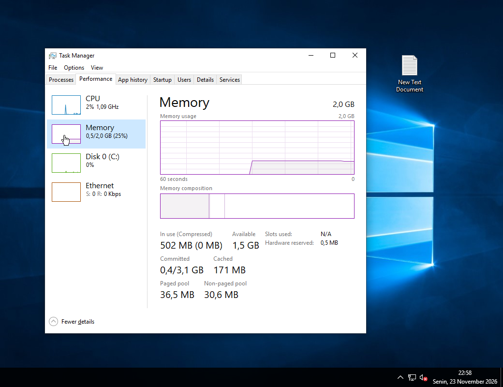
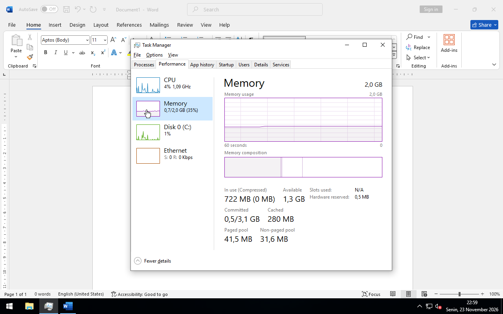
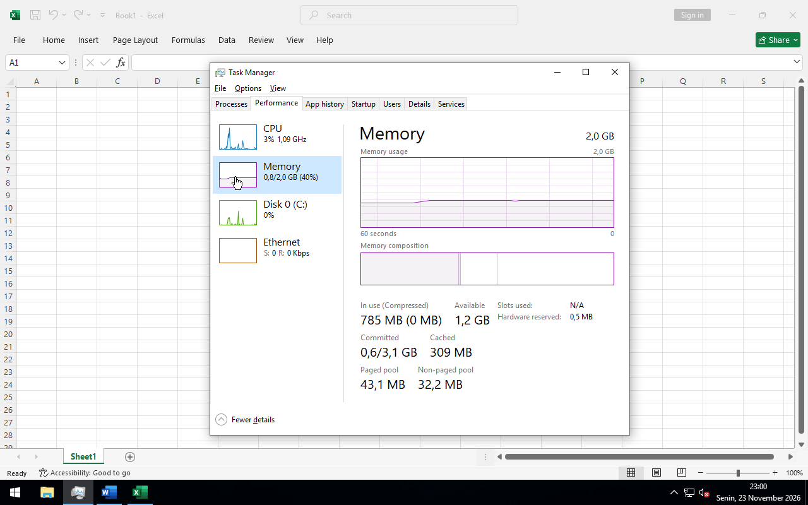
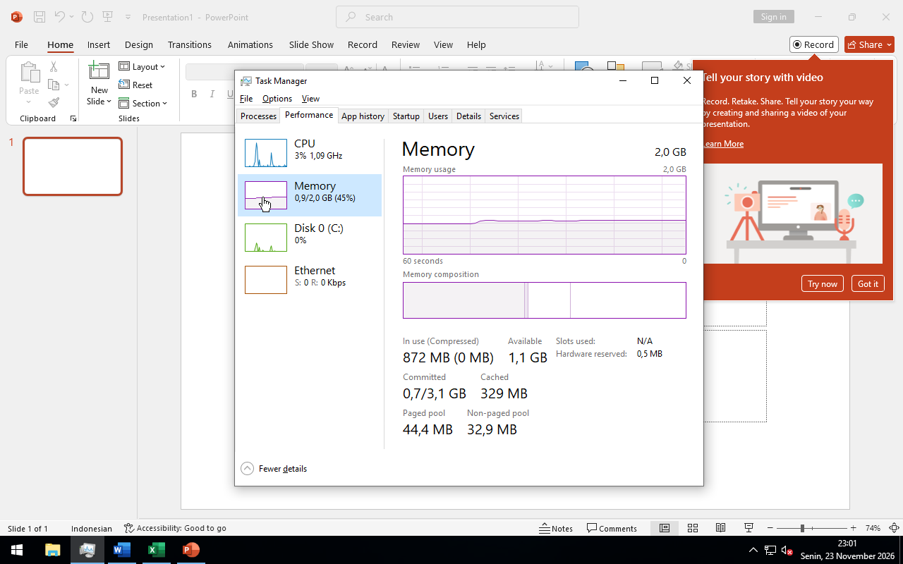
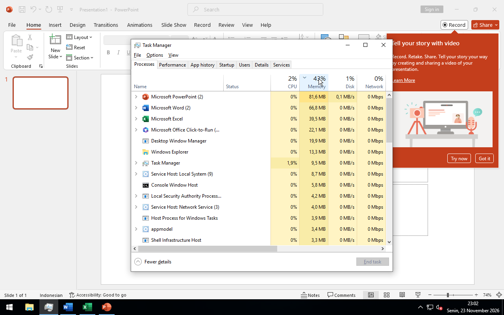

# DikNom VM Windows 10 untuk Microsoft Office 2024

**Eksperimen menjalankan Windows 10 di dalam VM pada laptop 4 GB, lalu
Microsoft Office 2024 di dalamnya.** Repo ini mendokumentasikan apa yang
benar-benar terukur, bukan klaim "Windows ringan" tanpa bukti.

Dibuat oleh **DikNom**. Status: **eksperimen / bukan rekomendasi produksi**.

> **Peringatan penting**
>
> - Repo ini **tidak menyimpan atau mendistribusikan ISO Windows**. ISO tiny10
>   adalah image modifikasi pihak ketiga dari **NTDEV**, bukan produk resmi
>   Microsoft.
> - Office 2024 memerlukan lisensi yang sah. Repo ini tidak berisi installer
>   Office, product key, aktivator, atau bahan ilegal.
> - Office 2024 resminya membutuhkan **4 GB RAM untuk guest**. Eksperimen ini
>   memakai guest **2 GB** di host 4 GB; hasilnya bisa jalan, tetapi berat dan
>   tidak didukung secara resmi.
> - tiny10 adalah image yang dipangkas. Komponen Windows, update, dan
>   kompatibilitas Office bisa berbeda dari Windows resmi.



## Hasil singkat

Diukur di guest Windows tiny10 dengan **2 GB RAM / 2 vCPU**, memakai Task
Manager Windows:

| Kondisi | RAM terpakai | Persentase | Available | Cached | CPU |
|---|---:|---:|---:|---:|---:|
| Windows idle | **502 MB** | **25%** | 1,5 GB | 171 MB | 2% |
| Word kosong | **722 MB** | **35%** | 1,3 GB | 280 MB | 4% |
| + Excel kosong | **785 MB** | **40%** | 1,2 GB | 309 MB | 3% |
| + PowerPoint kosong | **872 MB** | **45%** | 1,1 GB | 329 MB | 3% |

Memori proses saat ketiganya terbuka:

| Proses | Working set |
|---|---:|
| Microsoft PowerPoint | **81,6 MB** |
| Microsoft Word | **66,8 MB** |
| Microsoft Excel | **39,5 MB** |
| Microsoft Office Click-to-Run | **22,1 MB** |

Angka ini bukan "Office 2024 hanya butuh 872 MB". Itu total Windows + ketiga
aplikasi pada satu sesi kosong. Dokumen besar, gambar, dan workbook berat akan
menaikkan angka jauh lebih tinggi.

## Spesifikasi uji

**Host:**

- Dynabook K50/FR
- Intel Celeron N4020, 2 core / 2 thread
- RAM **4 GB tersolder** (tidak bisa upgrade)
- eMMC 64 GB
- Ubuntu 26.10, XFCE
- KVM/libvirt, QEMU

**Guest:**

- tiny10 **B4 x64** (Windows 10 build 17763 / 1809)
- 2 vCPU
- RAM **2048 MB**
- Disk qcow2 **10 GiB** (terpakai 9,23 GiB — hampir penuh)
- Disk SATA, network e1000
- VNC `127.0.0.1:5900`, SPICE `127.0.0.1:5901`
- Office **LTSC 2024 Click-to-Run**: Word, Excel, PowerPoint

**Beban host saat ketiga aplikasi terbuka:**

- RAM host: 3,7 GB total; sekitar **3,2 GB terpakai**
- Free: sekitar **168 MB**
- Swap: sekitar **1,5 GB**
- RSS QEMU: sekitar **1,6 GB**
- Free 168 MB itu **bukan RAM Windows saja**. Saat pengukuran, host juga
  menjalankan **Hermes Agent (sesi ini), Chrome, desktop XFCE, cache, dan
  zram/swap**. Jadi angka host terlihat hampir habis karena beban gabungan,
  bukan karena guest memakai seluruh 4 GB.
- CPU host **masih aman**: Celeron N4020 punya 2 core/2 thread. Task Manager
  guest membaca CPU **2% saat idle**, **4% saat Word**, dan **3% saat tiga
  aplikasi terbuka**. Proses QEMU sekitar **41–90%** (kira-kira 0,4–0,9 core,
  tergantung fase boot/aplikasi), jadi dua core tidak tersaturasi. Bottleneck
  utama ada di RAM dan eMMC, bukan CPU yang mentok.
- Sisa RAM untuk desktop Linux sangat sedikit, jadi host bisa terasa berat
  meskipun CPU tidak penuh.

## Screenshot

Semua screenshot memakai dokumen **kosong**. Tidak ada nama, alamat, nomor
telepon, atau file pribadi di screenshot. Jangan menambahkan screenshot
dokumen nyata ke repo ini.

### Windows idle — 502 MB (25%)


### Word kosong — 722 MB (35%)



### Word + Excel kosong — 785 MB (40%)



### Word + Excel + PowerPoint kosong — 872 MB (45%)



### Memori per proses



## Yang berhasil dan yang tidak

**Berhasil:**

- tiny10 boot di KVM dengan 2 GB RAM.
- Word, Excel, dan PowerPoint 2024 bisa dibuka bersamaan.
- Task Manager Windows membaca RAM dan proses dengan normal.
- Screenshot dan angka eksperimen bisa direproduksi.
- VNC/SPICE tersedia untuk melihat VM dari Remmina.

## Pengalaman penggunaan

Catatan ini adalah pengalaman langsung saat eksperimen, bukan benchmark
latensi atau angka FPS.

- **Mengetik terasa nyaman** untuk Word, Excel, PowerPoint, dan aplikasi
  ringan. Input keyboard, klik, scroll, dan pindah jendela tetap responsif
  selama tidak ada aplikasi berat lain di guest.
- Dokumen kosong dan dokumen ringan bisa dibuka dan diedit tanpa lag berarti.
- **Jangan membuka browser berat di guest.** Kalau perlu browsing di dalam
  Windows, batasi sekitar **4 tab**. Lebih dari itu, gunakan browser di host
  Linux atau remote ke mesin lain; RAM 2 GB akan cepat habis.
- **Saat VM menyala dan browser dibuka di host Linux, batasi sekitar 5 tab.**
  Ini lebih konservatif daripada browsing host tanpa VM. Jika bisa, pakai
  3–4 tab saja; tab video, web app berat, atau banyak ekstensi menaikkan
  kebutuhan RAM dengan cepat.
- Untuk kerja dokumen, lebih nyaman membuka Office saja di guest dan browser
  di host. Ini mengurangi tekanan RAM dan membuat input tetap lancar.

Batas 4 tab adalah saran konservatif, bukan hasil uji tab yang presisi. Setiap
tab dapat memakai puluhan sampai ratusan MB tergantung situs, ekstensi, dan
video.

**Batasan:**

- Host 4 GB adalah bottleneck utama. Guest 2 GB masih di bawah minimum resmi
  Office 2024 (4 GB).
- Disk 10 GiB terlalu kecil; Office membuat qcow2 membengkak ke 9,23 GiB.
  Gunakan **20 GiB** untuk pemakaian nyata.
- eMMC dan Celeron membuat opening file besar terasa lambat.
- tiny10 bukan Windows resmi; update/komponen bisa tidak lengkap.
- Status lisensi Office tidak termasuk pengukuran; gunakan lisensi sendiri.
- Jangan menganggap hasil ini "mulus" untuk dokumen besar atau kerja seharian.

## Mulai cepat

Baca panduan lengkap di:

- [`docs/terminal-prompts.md`](docs/terminal-prompts.md) — prompt terminal
  langkah demi langkah.
- [`docs/experiment.md`](docs/experiment.md) — metodologi dan angka lengkap.
- [`docs/office-2024.md`](docs/office-2024.md) — Office Deployment Tool dan
  lisensi.
- [`docs/source-and-licenses.md`](docs/source-and-licenses.md) — sumber ISO,
  NTDEV, Microsoft, dan lisensi.

Urutan singkat:

```bash
# 1. Siapkan host
./scripts/setup-host.sh

# 2. Unduh ISO dari sumbernya (butuh persetujuan)
./scripts/download-tiny10.sh

# 3. Buat VM
./scripts/create-vm.sh --iso "$HOME/Downloads/Tiny10 B4 x64.iso"

# 4. Pasang Windows lewat VNC/Remmina, lalu Office 2024 lewat ODT
# 5. Pasang shortcut kustom
install -m755 scripts/w10on scripts/w10off scripts/w10shutdown ~/.local/bin/
```

**Penting:** kata `w10on`, `w10off`, dan `w10shutdown` di repo ini adalah
contoh. Ganti dengan nama VM kamu sendiri. Misalnya kalau nama VM-mu
`vmkerja`, jadikan:

```text
vmkerjaon
vmkerjaoff
vmkerjashutdown
```

Caranya ada di [`docs/terminal-prompts.md`](docs/terminal-prompts.md#ganti-nama-shortcut).

## Struktur repo

```text
assets/experiment/          Screenshot eksperimen (dokumen kosong)
docs/experiment.md          Metodologi, angka, keterbatasan
docs/terminal-prompts.md    Prompt terminal lengkap
docs/office-2024.md         ODT dan catatan lisensi
docs/source-and-licenses.md Sumber ISO dan lisensi
scripts/setup-host.sh       Dependensi KVM/libvirt
scripts/download-tiny10.sh  Download ISO dari sumber NTDEV
scripts/create-vm.sh        Buat domain VM
scripts/w10on               Template start/resume
scripts/w10off              Template suspend
scripts/w10shutdown         Template shutdown bersih
scripts/office-configuration.xml  Contoh konfigurasi ODT
```

## FAQ

**Apakah ini berarti Office 2024 ringan?**
Bukan. Angka 45% hanya total Windows + tiga aplikasi kosong di guest 2 GB.
Office 2024 resmi meminta 4 GB RAM untuk guest.

**Apakah tiny10 didukung Microsoft?**
Tidak. tiny10 adalah image modifikasi NTDEV. Windows dan Office tetap
memerlukan lisensi yang sah.

**Apakah ISO tiny10 ada di repo ini?**
Tidak. Repo hanya berisi dokumentasi, skrip unduh, dan link sumber. ISO tidak
di-host di GitHub.

**Apakah bisa dipakai kerja sehari-hari?**
Untuk dokumen ringan mungkin; untuk kerja serius tidak disarankan. Host 4 GB
harus menanggung Linux + QEMU + guest 2 GB, dan eMMC/Celeron memperlambat
segalanya.

**Apakah angka RAM ini bisa berubah?**
Ya. Build tiny10, update Windows, driver, dokumen, dan background app dapat
mengubah hasil. Angka di repo adalah satu eksperimen terukur, bukan janji.

**Apakah Office di screenshot sudah berlisensi?**
Status aktivasi tidak diuji dan tidak diklaim. Gunakan lisensi sendiri.

## Kredit

- **DikNom** — eksperimen, dokumentasi, dan skrip.
- **NTDEV** — tiny10; lihat daftar resmi NTDEV dan Internet Archive.
- **Microsoft** — Windows dan Office; lisensi tetap milik Microsoft.

Repo ini bukan produk Microsoft dan tidak berafiliasi dengan NTDEV.
